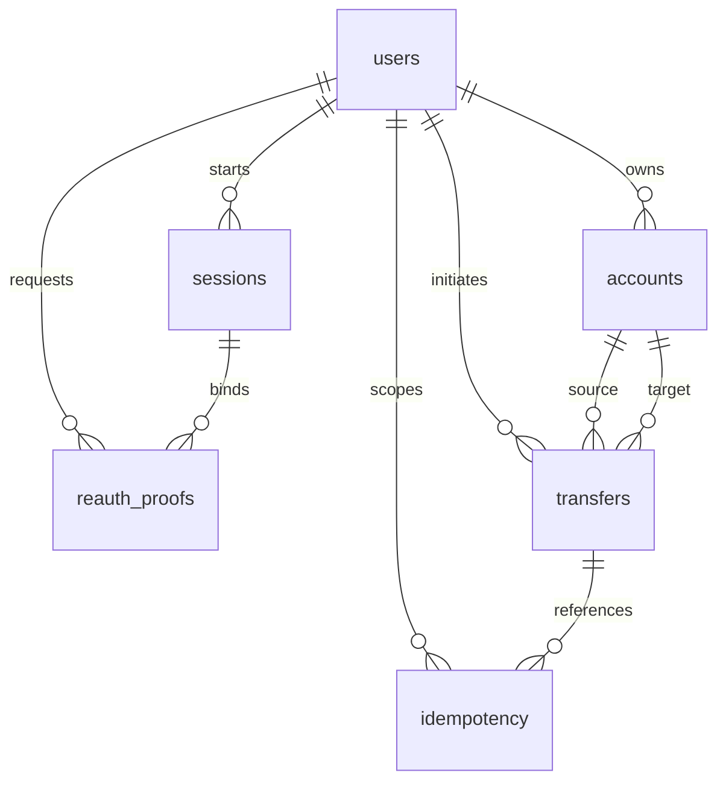

# Thiết kế bảy bảng dữ liệu

Schema hiện có nằm trong app/db/models.py. Các bảng này cùng ở SQLite; D1, D2, D4 là các nhóm dữ liệu logic, không phải ba máy chủ khác nhau.

## Danh mục

| Bảng | Dịch nghĩa | Vai trò |
|---|---|---|
| users | Người dùng | Danh tính, username, mật khẩu đã băm, vai trò |
| accounts | Tài khoản tiền | Chủ sở hữu và số dư |
| sessions | Phiên đăng nhập | User, thời hạn và trạng thái thu hồi |
| reauth_proofs | Bằng chứng xác thực lại | Gắn user/session/nội dung giao dịch, thời hạn và trạng thái dùng |
| transfers | Chuyển tiền | Một giao dịch đã ghi nợ/ghi có thành công |
| idempotency | Yêu cầu không xử lý trùng | Liên kết user/endpoint/key với giao dịch đã có |
| audit_events | Sự kiện kiểm toán | Chủ thể, hành động, cho phép/từ chối, lý do và trace |

## Khóa và trường

**users:** id là khóa chính; username UNIQUE; full_name là tên hiển thị; password_hash là Argon2id; role chỉ customer/operator. Không lưu password bản rõ.

**accounts:** id là khóa chính; user_id khóa ngoại users.id; balance số nguyên VND, CHECK balance>=0. Một người có thể có nhiều tài khoản; dữ liệu mẫu hiện mỗi người một tài khoản.

**sessions:** id khóa chính, dùng làm jti trong JWT; user_id tham chiếu users; expires_at là thời gian Unix theo giây; revoked đánh dấu thu hồi. Token không tự thay thế kiểm tra phiên server.

**reauth_proofs:** digest khóa chính là băm của proof, không lưu raw proof; user_id/session_id tham chiếu users/sessions; fingerprint gắn nội dung source/target/amount; expires_at thời hạn; consumed đánh dấu đã dùng. Backend phải kiểm tra user, session, fingerprint, expiry và consumed. Khóa ngoại chỉ bảo đảm đối tượng tồn tại, không tự bảo đảm session đó thuộc đúng user.

**transfers:** id khóa chính; user_id người thực hiện; source_account_id và target_account_id đều tham chiếu accounts; amount nguyên dương; created_at thời gian ISO UTC; day_utc phục vụ tổng hạn mức ngày. Bảng hiện chỉ lưu giao dịch commit thành công, không có trạng thái pending/failed. Từ chối được ghi audit.

**idempotency:** khóa chính ghép (user_id,endpoint,key); fingerprint yêu cầu; transfer_id khóa ngoại transfers.id. Cùng key của hai user là hai phạm vi khác nhau. Cùng key/khác nội dung phải bị backend từ chối. Cùng key/cùng nội dung trả giao dịch đã có. Bản hiện chưa có TTL dọn lịch sử tự động.

**audit_events:** id tự tăng; timestamp, trace_id, principal, action, decision, reason_code và transaction_id tùy chọn. principal và transaction_id không được khai báo là khóa ngoại trong bản này để có thể ghi cả sự kiện anonymous và yêu cầu bị từ chối. Có thể đối chiếu mã giao dịch nhưng không coi đó là quan hệ FK được DB tự bảo đảm. Không đưa password/token/proof vào audit.

## Quan hệ chính

Audit được mô tả riêng vì schema không khai báo FK của nó. Các quan hệ trên biểu diễn ràng buộc tham chiếu đang có, không thay thế các kiểm tra nghiệp vụ trong services.

## Kết nối và transaction

- connect() mở kết nối, bật foreign_keys và busy_timeout, trả hàng theo tên cột, luôn đóng kết nối.
- initialize() tạo thư mục/file/schema nếu cần và bật WAL. CREATE TABLE IF NOT EXISTS không phải công cụ migration: nếu thay cấu trúc bảng đã có, phải có kế hoạch nâng cấp schema.
- transaction() dùng BEGIN IMMEDIATE, commit nếu hoàn thành và rollback nếu xảy ra lỗi. SQLite tuần tự hóa tác vụ ghi trong bản demo; không tương đương cơ chế đồng thời của DB phân tán.

Ví dụ giao dịch chuyển 100.000 VND A→B: kiểm tra điều kiện → trừ ACC_A → cộng ACC_B → lưu transfers/idempotency → đánh dấu proof consumed → ghi audit thành công → commit. Một bước lỗi trước commit thì rollback cả giao dịch. Không tự commit giữa trừ và cộng.

## Repository và service khác nhau

- Repository: biết câu SQL và cách trả dữ liệu; dùng tham số cho giá trị input.
- Service: biết ai được làm gì, giới hạn, kiểm tra số dư và phạm vi transaction.

Một row transfers tham chiếu accounts không tự chứng minh user sở hữu source. Phân quyền phải kiểm tra tại backend. Hạn mức mỗi lần/ngày cũng không được bảo đảm bởi CHECK(amount>0) đơn lẻ.

## Trình tự học

1. Đọc users/accounts trước để phân biệt người và tài khoản tiền.
2. Đọc transfers/idempotency để hiểu lưu giao dịch và trả lại kết quả cũ.
3. Đọc sessions/reauth_proofs để hiểu dữ liệu phục vụ bảo mật.
4. Đọc audit_events để hiểu minh chứng cho phép/từ chối.
5. Chạy seed_data rồi inspect_database; tiếp theo đọc repositories.

Inspector kiểm tra cấu trúc và dữ liệu, không tự gửi giao dịch. Chỉ nối và thử luồng chuyển tiền khi học phần backend.
